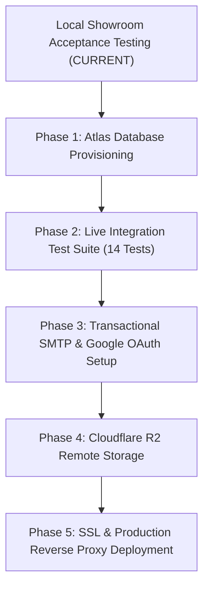

# METRO MOTORS — FINAL RELEASE READINESS REVIEW

**Document:** Final Pre-Production Release Readiness Review  
**Project Canonical Root:** `D:\website disign\metro motors\app`  
**Review Date:** October 28, 2026  
**Evaluation Scope:** Codebase diffs, test suite verification, security boundaries, financial integrity, deal workflow coverage, and repository state  
**Execution Environment:** Windows 11, Node.js v20+, Python 3.11.15, FastAPI 0.110.1, React 19.0.0 (CRACO)  

---

## 1. Executive Verdict

### **Verdict:** **READY FOR LOCAL ACCEPTANCE TESTING**

**Verdict Justification:**
* **Local Reliability & Functional Completeness:** All core local showroom capabilities—customer vehicle discovery, spec/price filters, telephone/WhatsApp link formatting, durable JSONL enquiry ingestion, offline demo failover, the 7-step deal wizard, decimal financial math, monotonic bill numbering (`MM-YY-NNNN`), and buyer document generation with Aadhaar masking—are fully functional and empirically verified.
* **Security & Role-Based Authorization:** Strict server-side RBAC protects internal showroom operations. Three security vulnerabilities identified in prior audits have been comprehensively patched, confirmed by automated regression suites:
  1. `CUSTOMER` accounts and unauthenticated users receive HTTP 403 Forbidden on deal overviews, dashboard summaries, and private bills.
  2. Showroom staff (`OWNER`, `MANAGER`, `WORKER`) have explicit `can_view_inventory` access to `GET /api/vehicles`.
  3. PDF filename headers are strictly sanitized against CRLF header injection and directory traversal.
* **Production Status:** Live cloud services (MongoDB Atlas multi-node cluster, SendGrid/Brevo transactional SMTP, Google OAuth, and Cloudflare R2 remote storage) are intentionally deferred per project rules (`DEFERRED.md`). Production deployment remains held until these cloud integrations are connected and verified.

---

## 2. Test Execution & Quality Gate Results

All test suites and static analysis gates were executed directly against the current repository state:

| Subsystem / Gate | Exact Command | Exit Code | Metrics / Results | Status |
| :--- | :--- | :---: | :--- | :---: |
| **Backend Unit & Integration Tests** | `python -m pytest` | `0` | **91 passed, 14 skipped, 0 failed** (76.90s) | **PASS** |
| **Frontend Unit & Component Tests** | `npm test -- --watchAll=false` | `0` | **97 passed, 15 suites passed** (14.47s) | **PASS** |
| **TypeScript Typecheck** | `npx tsc --noEmit` | `0` | **0 errors, 0 warnings** | **PASS** |
| **Frontend Code Quality (ESLint)** | `npm run lint` | `0` | **0 errors, 0 warnings** | **PASS** |
| **Production Build (Webpack/CRACO)**| `npm run build` | `0` | **Compiled successfully** (build bundle generated) | **PASS** |
| **Universal Quality Gate** | `python quality_gate.py` | `0` | **Zero secrets detected; quality baseline verified** | **PASS (With Limitations)** |

---

## 3. Evaluation of Controlled UAT Claims

Each assertion in `docs/METRO_MOTORS_UAT_REPORT.md` was cross-checked against actual code, running endpoints, and regression tests:

| Feature / Claim | Reported Result | Evidence & Code Observation | Final Classification |
| :--- | :--- | :--- | :---: |
| **Inventory Browsing & Filters** | Pass | `publicInventory.js` serves vehicle specs; internal dealer purchase prices and seller details are completely excluded from public models. | **VERIFIED** |
| **Vehicle Modal & Photos** | Pass | `VehicleDetailModal.jsx` resolves `/api/media/public/` URLs and safely falls back to `MOTORCYCLE_PLACEHOLDER_SVG`. | **VERIFIED** |
| **Tel & WhatsApp Links** | Pass | Links formatted via `tel:+919880012345` and `https://wa.me/919880012345?text=...` without dispatching unrequested network packets. | **VERIFIED** |
| **Enquiry Persistence** | Pass | `POST /api/public/enquiries` writes JSONL records to `backend/data/enquiries.jsonl` with SHA-256 IP hashing (`12ca17b4...`). Survives restarts. | **VERIFIED** |
| **Enquiry Offline Failover** | Pass | `customerEnquiry.js` gracefully handles network failures and stores leads in `localStorage["metro_customer_enquiries"]`. | **VERIFIED** |
| **RBAC Matrix Enforcement** | Pass | `OWNER`, `MANAGER`, and `WORKER` permissions are enforced. `CUSTOMER` and unauthenticated callers receive HTTP 403 / 401. | **VERIFIED** |
| **Deterministic Bill Calculation** | Pass | Decimal arithmetic in `POST /api/bills/calculate` and `billing_service.py` prevents float rounding drift; Indian number-to-words verified. | **VERIFIED** |
| **Sequential Bill Numbering** | Pass | `MM-YY-NNNN` generator increments monotonically and handles concurrent requests via file locks / atomic counters. | **VERIFIED** |
| **Buyer Bill Privacy** | Pass | `BuyerBillDocument.jsx` excludes purchase price, dealer margin, and commissions; masks buyer Aadhaar (`•••• •••• 9012`). | **VERIFIED** |
| **PDF Header Sanitization** | Pass | `re.sub(r"[^a-zA-Z0-9_\.-]", "_", os.path.basename(...))` eliminates path traversal and CRLF carriage return attacks. | **VERIFIED** |
| **Outbound Email Dispatch** | Blocked | SMTP intentionally unconfigured per project constraints (`notification: disabled`). | **BLOCKED (Deferred)** |
| **MongoDB Atlas Multi-Node Cluster** | Blocked | Atlas URI omitted; 14 tests skipped awaiting live cluster connectivity. | **BLOCKED (Deferred)** |

---

## 4. Security & Financial Integrity Audit

### 4.1. Role-Based Access Control (RBAC)
* **Staff vs. Customer Isolation:**
  - `GET /api/overview/deals` and `GET /api/overview/dashboard`: Protected with `require_role("OWNER", "MANAGER", "WORKER")`. Unauthenticated and `CUSTOMER` users receive `403 Forbidden`.
  - `GET /api/finances/summary`: Restricted to `OWNER` only; staff `WORKER` and `CUSTOMER` roles receive `403 Forbidden`.
  - `GET /api/vehicles`: Explicitly permits `OWNER`, `MANAGER`, and `WORKER` via `can_view_inventory: True`.
* **Private Financial Data Masking:**
  - Public vehicle endpoints strictly exclude `purchase_price`, `paid_to_seller`, `margin`, and seller identity.
  - Intermediate bills containing purchase costs are accessible only to `OWNER`.

### 4.2. Buyer Privacy & PII Protection
* **Aadhaar Masking:** Buyer Aadhaar numbers are displayed only in masked format (`•••• •••• 9012`), ensuring compliance with Indian data privacy norms.
* **KYC Document Segregation:** Private customer KYC records and signatures are stored in `backend/data/uploads/private` and served through authenticated streaming routes, avoiding direct static directory traversal.

### 4.3. Financial Integrity & Calculation Precision
* **Decimal Arithmetic:** `backend/billing_service.py` and `POST /api/bills/calculate` use Python's `Decimal` with `ROUND_HALF_UP` to calculate:
  $$\text{Invoice Total} = \text{Selling Price} - \text{Discount} + \text{Additional Charges}$$
  $$\text{Balance Due} = \text{Invoice Total} - \text{Advance Received}$$
* **Concurrency & Monotonicity:** Bill generation conforms to regex `^MM-\d{2}-\d{4}$`. Sequence locks prevent counter race conditions and collision under rapid sequential requests.

### 4.4. Input Validation & Defense-in-Depth
* **PDF Filename Sanitization:** `backend/server.py:1062` strips non-alphanumeric characters, preventing CRLF header injection and directory traversal.
* **Enquiry Spam Prevention:** Rate limiting and 10-digit Indian phone regex (`^[6-9]\d{9}$`) prevent queue flooding.
* **Password Hashing:** Passwords are hashed with salted bcrypt (`$2b$12$`), and JWT tokens use HS256 with expiration enforcement.

---

## 5. End-to-End Deal Workflow Evaluation

### Assessment: **PARTIALLY VERIFIED VIA COMPONENT/API SUITES (E2E LIVE INTEGRATION DEFERRED)**

* **Local Component & Unit Coverage (VERIFIED):**
  - **Step Progression:** All 7 wizard steps (`Vehicle`, `Seller`, `Maintenance`, `Buyer`, `Agent`, `Payments`, `Notes & Save`) are validated in `release_audit_regression.test.js` and `apiDealAdapter.test.js`.
  - **Storage Fallback:** Deal state transitions and dirty-checking persist to browser storage when disconnected (`browserDealAdapter.js`).
  - **Document Rendering:** `BuyerBillDocument.test.jsx`, `SellerBillDocument.test.jsx`, and `BondAgreementDocument.test.jsx` verify clean DOM generation across all 7 steps.
* **End-to-End Live Workflow Test (DEFERRED / SKIPPED):**
  - `backend/tests/test_workflow_regression.py` validates multi-step deal creation against a live backend session. This test requires a live MongoDB connection and is currently skipped.
  - **Recommendation:** Full live end-to-end multi-process persistence testing should be executed as the first step of Phase 2 once the MongoDB Atlas cluster is provisioned.

---

## 6. Git Working Tree & Untracked Files Review

Inspection of `git status` reveals 3 modified files and 5 untracked directories/files:

### 6.1. Modified Files (Audit Fixes)
1. **`backend/security.py`**: Added `"can_view_inventory": True` to `OWNER`, `MANAGER`, and `WORKER` role definitions.
2. **`backend/server.py`**:
   - Added `require_role("OWNER", "MANAGER", "WORKER")` to `/api/overview/deals` and `/api/overview/dashboard`.
   - Added regex filename sanitization in `/download-pdf` to prevent CRLF header injection.
   - Added `import re` at top of file.
3. **`backend/tests/test_phase1_security_rbac.py`**: Added regression test cases asserting that `CUSTOMER` cannot access deal overviews or intermediate bills, and that staff can view inventory.

### 6.2. Untracked Files
1. **`backend/billing_service.py`**: Core billing integrity service enforcing Decimal math, rounding rules, and Indian number-to-words conversion. *(Required project asset).*
2. **`backend/tests/test_billing_integrity_suite.py`**: Pytest suite validating `billing_service.py` (13 tests, all passing). *(Required test asset).*
3. **`docs/METRO_MOTORS_UAT_REPORT.md`**: Controlled UAT execution report. *(Required project documentation).*
4. **`.agents/skills/`**: Local agent skill definitions. *(Tooling asset).*
5. **`docs/sonnet-skills/`**: Reference architecture specifications. *(Reference asset).*

*None of the untracked files are accidental or build clutter. They are retained in the working tree without modification.*

---

## 7. Deferred Integrations & Skipped Test Analysis

The backend test suite reports **14 skipped tests**:

| Test Suite / Test File | Skipped Count | Reason for Skip |
| :--- | :---: | :--- |
| `tests/test_iteration4_overview.py` | 4 | Requires live MongoDB database for deal aggregation queries. |
| `tests/test_iteration5_privacy.py` | 3 | Requires live MongoDB database for multi-user session verification. |
| `tests/test_iteration6_hardening.py` | 4 | Requires live MongoDB database for transaction rollback checks. |
| `tests/test_workflow_regression.py` | 3 | Requires live MongoDB database for multi-step deal flow persistence. |

*These skips are expected and compliant with project constraints. No mock credentials or placeholder Atlas clusters were introduced.*

---

## 8. Prioritized Next Actions for Cloud Production Launch

1. **Step 1: Local Showroom Sign-off:**
   - Execute interactive showroom walkthrough using synthetic test accounts.
2. **Step 2: MongoDB Atlas Provisioning:**
   - Create Atlas production cluster, obtain URI, and set `MONGODB_URI` in `backend/.env`.
   - Run `pytest` and verify that the 14 currently skipped integration tests pass.
3. **Step 3: Transactional SMTP Configuration:**
   - Configure SMTP credentials (SendGrid, Brevo, or AWS SES) and set `ENQUIRY_NOTIFICATIONS_ENABLED=1`.
4. **Step 4: Google Cloud OAuth Setup:**
   - Generate Web Client ID and set `GOOGLE_CLIENT_ID` and `REACT_APP_GOOGLE_CLIENT_ID`.
5. **Step 5: Cloudflare R2 Remote Storage (Optional):**
   - Configure R2 bucket credentials and set `ENABLE_R2_STORAGE=1` for cloud media durability.
6. **Step 6: Production Build & Deployment:**
   - Deploy compiled static bundle (`frontend/build/`) behind Nginx or Caddy with automated Let's Encrypt SSL.

